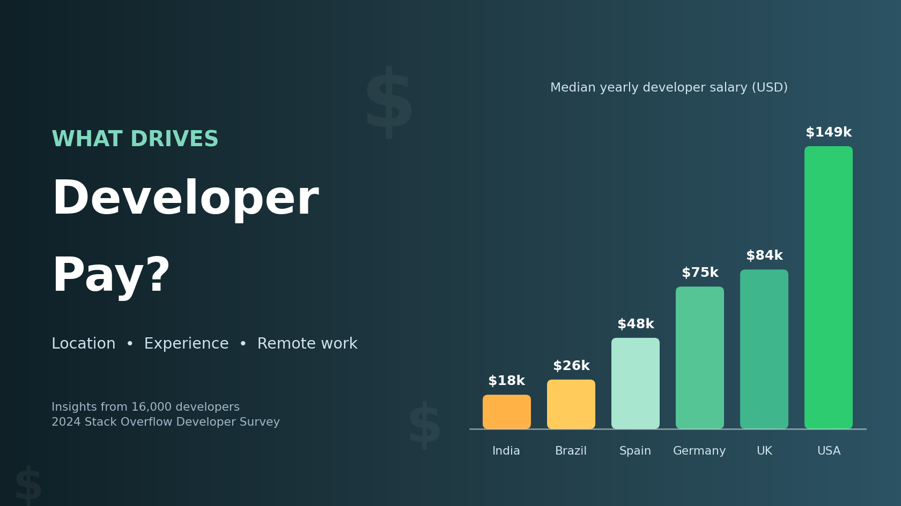
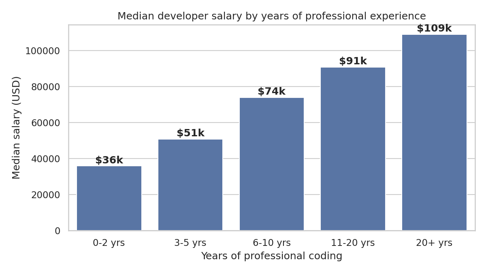
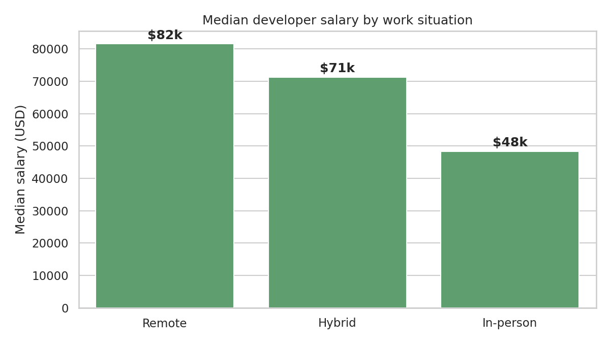
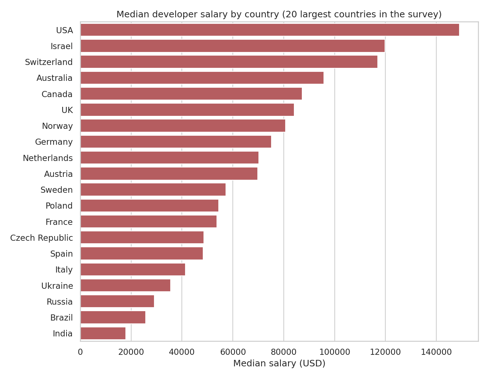
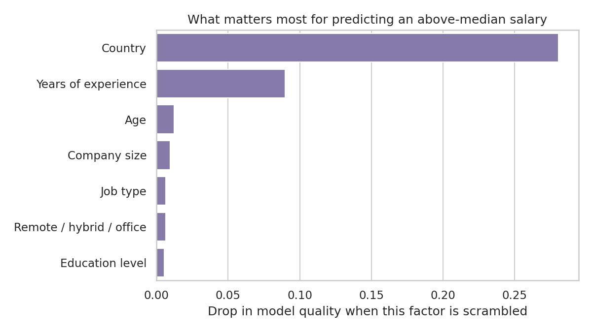

# Where You Live Matters More Than Your Degree: What 16,000 Developers Reveal About Pay

Every year, Stack Overflow asks tens of thousands of software developers about their work and their pay. I studied the 2024 survey, focusing on almost 16,000 full-time professional developers who shared their salary, to answer one big question: **what actually drives a developer's pay?**

I broke it into four smaller questions:

1. Does experience pay off?
2. Do remote developers earn more?
3. How much does location matter?
4. Can we predict who earns more, and what matters most?

## 1. Does experience pay off?

Yes, steadily. The typical developer with 0 to 2 years of experience earns about **$36,000** a year. By 6 to 10 years that roughly doubles to **$74,000**, and after 20 years it reaches about **$109,000**.

The biggest gains come in the first ten years of a career.

## 2. Do remote developers earn more?

Remote developers report the highest typical pay (**$82,000**), followed by hybrid (**$71,000**) and fully in-office (**$48,000**).

You might think this is only because remote workers live in richer countries, but the gap holds inside the same country too. In the USA, remote developers earn around $155,000, compared with $112,000 for in-office developers. One caution: this shows that remote work and higher pay go together, not that going remote will *give* you a raise.

## 3. How much does location matter?

More than anything else. A typical developer in the USA earns about **$149,000**, roughly double Germany ($75,000) and about **eight times** India ($18,000).

These figures are in US dollars and don't account for living costs, but the gap is striking.

## 4. Can we predict who earns more?

I trained a computer model on seven facts about each developer: country, experience, job type, education, company size, age and work arrangement. It correctly guessed whether someone earns above or below the middle salary ($70,000) **83% of the time**, where a coin flip would manage 50%.

**Country came first by a wide margin, then experience.** Education level mattered least of all.

To test it, I imagined *Sara*, a back-end developer in Germany with 4 years of experience who works in the office. The model gives her about a **1-in-3 chance** of earning above $70,000. A remote role raises that to more than **1 in 2**, about the same boost as four more years of experience.

## The takeaway

Where you work, and how, shapes developer pay far more than your degree. Experience still pays, but if you want to grow your income, explore remote roles and companies in higher-paying markets.

*The full analysis and code are on GitHub: https://github.com/ralbusaidi3-hub/stackoverflow-salary-analysis*
